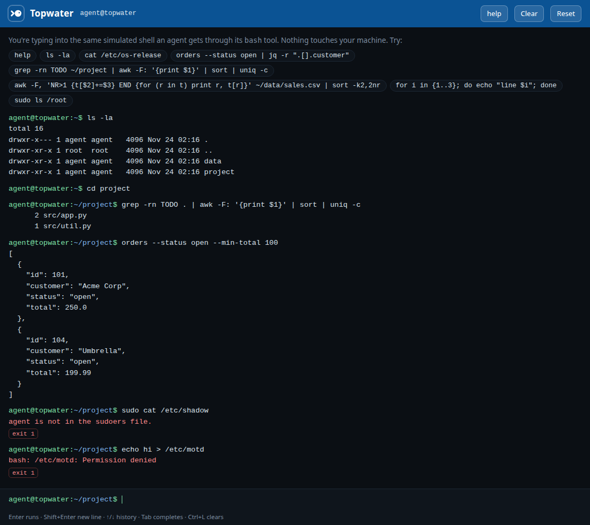

<p align="center">
  <picture>
    <source media="(prefers-color-scheme: dark)" srcset="assets/brand/topwater_lockup_dark.png">
    
  </picture>
</p>

<h3 align="center">Your agent already knows how to use a computer. Give it one.</h3>

<p align="center">
  Topwater turns your app's tools into commands on a simulated Linux machine,<br>
  so your agent needs just one tool: <code>bash</code>.
</p>

<p align="center">
  <b>Python</b> and <b>C#</b> · runs inside your process · no containers · no dependencies
</p>

---

```console
agent@topwater:~$ orders --status open | jq -r '.[].customer'
Acme Corp
Umbrella
agent@topwater:~$ to-markdown policies/travel.docx | grep "Tier 1"
| Tier 1 | London, New York, Tokyo, Zurich | 95 |
agent@topwater:~$ sudo rm -rf /
agent is not in the sudoers file.
```

## Why

Every tool you hand a model is something new it has to learn from a description. The shell is different:
models have seen millions of terminal sessions, and they are very good at `grep`, pipes and `--help`.

Topwater puts your tools where the model is already fluent:

- **One tool instead of twenty.** Your functions become programs. The model combines them with pipes, loops and
  files instead of juggling JSON calls.
- **A real-feeling machine.** Files, permissions, about 100 standard commands, even `/etc/os-release`. The model
  explores it the way it would explore any server.
- **Nothing escapes.** It is a simulation inside your process. There is no real shell, and the agent's files
  live in memory.

## Quick start

**Python** (3.10+)

```bash
pip install ./python
```

```python
import topwater
from topwater import Shell, command

class Tools:
    @command("orders", description="List orders")
    def orders(self, status: str | None = None, limit: int = 20):
        return db.orders(status, limit)              # returned objects print as JSON

shell = Shell().register(Tools())
shell.fs.write_text("/home/agent/notes.txt", "hi")   # give the agent some files

# Hand the model one tool...
tool = {"name": topwater.TOOL_NAME, "description": topwater.TOOL_DESCRIPTION, "input_schema": topwater.TOOL_INPUT_SCHEMA}

# ...and run whatever it asks for.
output = await topwater.execute_tool(shell, 'orders --status open | jq length')
```

<details>
<summary><b>C#</b> (.NET 8)</summary>

```csharp
using Topwater;

public class Tools
{
    [Command("orders", Description = "List orders")]
    public List<Order> Orders(string? status = null, int limit = 20) => Db.Orders(status, limit);
}

var shell = new Shell().Register(new Tools());
shell.Fs.WriteAllText("/home/agent/notes.txt", "hi");

// Tool definition: BashTool.Name, BashTool.Description, BashTool.InputSchemaJson
string output = await BashTool.ExecuteAsync(shell, "orders --status open | jq length");
```

Add a project reference to `src/Topwater/Topwater.csproj`.

</details>

That's the whole integration. `orders --help` is written for you, and the agent finds your commands with `help`.

## Try it yourself

```bash
cd python && PYTHONPATH=src python -m topwater.web --demo      # open http://127.0.0.1:8000
```

A small web terminal for typing commands into the same machine your agent gets.

<p align="center"></p>

## What agents do with it

Three examples, each run end to end by a real model (Gemini Flash) and checked automatically.

| | What the agent did | Result |
|---|---|---|
| **[Answer from your documents](python/examples/usecase_document_helpdesk.py)** | Searched a Word policy, an Excel sheet, a web page and a 57-page PDF with `to-markdown`, then answered five employee questions with sources | 6 / 6 checks |
| **[Analyse your database](python/examples/usecase_sql_analyst.py)** | Explored a SQLite database through a read-only `sqlite3`, wrote a revenue report to CSV, answered two follow-ups | 7 / 7 checks |
| **[Drive a real program](python/examples/usecase_real_cli.py)** | Cut a release with the real `git`: branch, version bump, changelog, commit, tag | 10 / 10 checks |

The third one uses a bridge that exposes any real program on your machine as a command
(git, [OfficeCLI](https://github.com/iOfficeAI/OfficeCLI), ffmpeg, your own binaries) while the agent keeps
working on its virtual files. It is one line, `register_host_command(shell, "git")`, and it comes with a
[warning worth reading](docs/reference.md#real-host-programs).

## What's in the box

- **A real shell language.** Pipes, redirects, loops, functions, heredocs, `$(...)`, `set -e`, scripts.
- **About 100 standard commands.** `grep`, `sed`, `awk`, `jq`, `find`, `sort`, `diff`, `xargs` and friends.
- **Document reading.** Word, Excel, PowerPoint, PDF and HTML become searchable Markdown.
- **A regular user account.** The agent owns its home folder. System files are read-only and `sudo` says no.
- **Guard rails.** Runaway loops stop, long output is trimmed, and a crashing tool returns an error instead of
  taking down your agent.

The full list is in the [reference](docs/reference.md).

## Does it actually work?

We gave Gemini Flash six everyday tasks with nothing but the `bash` tool, and tried three ways of describing
the machine to it:

| How the tool was described | Tasks solved | Wasted commands per task |
|---|---|---|
| "An ordinary Linux machine" | 9 / 12 | 2.9 |
| **"A sandboxed shell. No Python, network or git." (the default)** | **11 / 12** | **1.7** |
| "A simulated environment" | 9 / 12 | 2.8 |

Being honest about the limits worked best. Pretending to be a normal machine sent the model looking for Python
and git, and it gave no benefit to tell it the machine was fake.

Small details matter more than you would expect. In one run the model stopped trusting the machine because a
database file was 16 bytes long. In another it spent its turns re-running `chmod` because `ls -l` did not
change. Both are fixed, and each problem a real model found in the shell is now a test.

Run it yourself: `python/examples/gemini_harness.py`.

## Good to know

- **Python and C# behave the same**, and share the same test cases. The web terminal and the examples are
  Python only.
- **Not on PyPI or NuGet yet.** Install from this repository.
- **No Python or network inside the machine.** Agents reach for both. The default tool description tells them
  up front.
- **PDFs need `pdftotext`** on your machine. Everything else has no dependencies.
- **A real program you register is real.** The simulation does not contain it. See the
  [reference](docs/reference.md#real-host-programs).

## Development

```bash
dotnet test                                           # C#
cd python && python -m unittest discover -s tests     # Python
```

The two versions do not share code. A behaviour change goes into both, with a test in both.

## License

Not chosen yet. The shell was written from scratch, so any license is possible.
