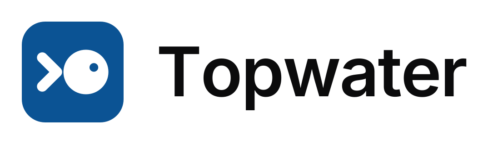

<p align="center">
  <picture>
    <source media="(prefers-color-scheme: dark)" srcset="assets/brand/topwater_lockup_dark.png">
    
  </picture>
</p>

<p align="center">
  One <code>bash</code> tool for your LLM agent, backed by a simulated Linux shell that runs inside your application.
</p>

<p align="center">
  <a href="https://www.nuget.org/packages/Topwater"></a>
  <a href="https://github.com/gr-ant/Topwater/actions/workflows/ci.yml"></a>
  <a href="LICENSE"></a>
</p>

<p align="center">
  <a href="https://gr-ant.github.io/Topwater/"><strong>Try it out in your browser →</strong></a>
  &nbsp;·&nbsp;
  <a href="https://gr-ant.github.io/Topwater/replay.html">Replay viewer</a>
</p>

Topwater is a library for **.NET**, **Python** and **TypeScript**. You register your functions, MCP servers and
HTTP APIs; the model sees them as command-line programs on a small Linux machine and reaches all of them through a
single tool:

```console
agent@topwater:~$ help | grep orders
  orders       List orders
agent@topwater:~$ orders --help
Usage: orders [--status <text>]

List orders

Options:
  --status <text>
agent@topwater:~$ orders --status open | jq length
2
```

- **One tool definition** instead of one per function. The model discovers programs with `help` and `--help`.
- **Composition.** Your tools pipe into `jq`, `grep`, `awk` and each other, and results can be kept in files.
- **Nothing real by default.** Commands are interpreted in your process against an in-memory filesystem, with
  limits on time, memory, disk and output. See [Safety](#safety).

## Quickstart

Each example registers one function and runs the command a model would send. All three print `2`.

### .NET

Requires .NET 8 or later.

```bash
dotnet add package Topwater --prerelease
```

```csharp
using Topwater;

var shell = new Shell();
shell.Register(new Tools());

// Every call the model makes to its bash tool goes through this one method.
Console.WriteLine(await BashTool.ExecuteAsync(shell, "orders --status open | jq length"));

public record Order(int Id, string Customer, string Status);

public class Tools
{
    static readonly Order[] All = [new(1, "Acme", "open"), new(2, "Globex", "shipped"), new(3, "Acme", "open")];

    [Command("orders", Description = "List orders")]
    public IEnumerable<Order> Orders(string? status = null) =>
        All.Where(o => status is null || o.Status == status);
}
```

Add `Topwater.Mcp` for MCP servers and `Topwater.AI` for Microsoft.Extensions.AI. `Topwater.Containers` turns the machine
into a Docker image and back, and `Topwater.Replay` replays recordings. An exported image holds what the agent wrote (its
files, scripts and `~/.bashrc`, which a shell in the image runs): treat it as untrusted and run it as carefully as the
agent itself.

### Python

Requires Python 3.10 or later. Preview, not on PyPI yet.

```bash
pip install "git+https://github.com/gr-ant/Topwater#subdirectory=python"
```

```python
from topwater import Shell, command

ORDERS = [
    {"id": 1, "customer": "Acme", "status": "open"},
    {"id": 2, "customer": "Globex", "status": "shipped"},
    {"id": 3, "customer": "Acme", "status": "open"},
]

class Tools:
    @command("orders", description="List orders")
    def orders(self, status: str | None = None):
        return [o for o in ORDERS if status in (None, o["status"])]

shell = Shell().register(Tools())

# Every call the model makes to its bash tool goes through this one line.
print(shell.run("orders --status open | jq length").to_tool_output())
```

Inside async code, use `await topwater.execute_tool(shell, command)` instead of `shell.run`.

### TypeScript

Requires Node 22 or later. Preview, not on npm yet. The package is an ES module.

```bash
git clone https://github.com/gr-ant/Topwater
(cd Topwater/typescript && npm install && npm run build)
npm install ./Topwater/typescript
```

```ts
import { Shell, BashTool } from 'topwater';

const ORDERS = [
  { id: 1, customer: 'Acme', status: 'open' },
  { id: 2, customer: 'Globex', status: 'shipped' },
  { id: 3, customer: 'Acme', status: 'open' },
];

const shell = new Shell();
shell.registerTools(
  'shop',
  [{ name: 'orders', description: 'List orders', inputSchema: { type: 'object', properties: { status: { type: 'string' } } } }],
  (tool, args) => ({ text: JSON.stringify(ORDERS.filter(o => !args.status || o.status === args.status)) }),
);

// Every call the model makes to its bash tool goes through this one method.
console.log(await BashTool.execute(shell, 'shop orders --status open | jq length'));
```

TypeScript describes tools with a JSON Schema, so the function appears as a subcommand: `shop orders`.

### No code: command line and MCP server

`topwater mcp` is an MCP server with one sandboxed `bash` tool, for Claude Desktop, Cursor, VS Code or any MCP
client. `topwater` alone opens a shell on the simulated machine.

A standalone binary, no .NET needed (from `0.1.0-preview.3`):

```bash
curl -fsSL https://gr-ant.github.io/Topwater/install.sh | sh          # Linux, macOS
```

```powershell
irm https://gr-ant.github.io/Topwater/install.ps1 | iex               # Windows: then topwater works in PowerShell and CMD
```

Or as a .NET tool: `dotnet tool install -g Topwater.Cli --prerelease`. The scripts check the download against the
release's `SHA256SUMS`; binaries for every platform are on the [releases page](https://github.com/gr-ant/Topwater/releases).

See [Command line and MCP server](docs/reference.md#command-line-and-mcp-server).

## Connect it to a model

Give the model one tool, using the name, description and input schema that Topwater provides. When the model calls
it, run the command and return the text.

| | Tool definition | Run a call |
|---|---|---|
| **.NET** | `BashTool.Name`, `BashTool.Description`, `BashTool.InputSchemaJson` | `await BashTool.ExecuteAsync(shell, command)` |
| **Python** | `topwater.TOOL_NAME`, `TOOL_DESCRIPTION`, `TOOL_INPUT_SCHEMA` | `await topwater.execute_tool(shell, command)` |
| **TypeScript** | `BashTool.name`, `BashTool.description`, `BashTool.inputSchema` | `await BashTool.execute(shell, command)` |

The tool takes one string argument, `command`. Files, variables and the working directory persist between calls.
Use one shell per conversation; a shell is not safe to share between threads.

Adapters do the wiring for common frameworks:

- **.NET:** with Microsoft.Extensions.AI, `options.Tools = [shell.AsAIFunction()]` (package `Topwater.AI`). Semantic
  Kernel takes the same function: `kernel.Plugins.AddFromFunctions("shell", [shell.AsAIFunction().AsKernelFunction()])`.
- **Python:** LangChain and LlamaIndex, see [python/README.md](python/README.md#langchain-and-llamaindex).
- **TypeScript:** Vercel AI SDK and OpenAI Agents, see
  [typescript/README.md](typescript/README.md#vercel-ai-sdk-and-openai-agents).

## Add your own programs

| | .NET | Python | TypeScript |
|---|---|---|---|
| Your functions | `[Command]` methods, `shell.Register(obj)` | `@command` methods, `shell.register(obj)` | `shell.register(name, handler, description)` |
| Tools described by JSON Schema | `shell.RegisterTools(...)` | `register_tools(shell, ...)` | `shell.registerTools(...)` |
| An MCP server | `shell.MountMcpAsync(...)` (package `Topwater.Mcp`) | `topwater.mcp.mount_mcp(shell, ...)` | `shell.mountMcp(...)` |
| An HTTP API, credentials hidden from the model | `shell.RegisterApi(...)` | `register_api(shell, ...)` | `shell.registerApi(...)` |
| A real program from your machine | `shell.RegisterHostCommand("git")` | `register_host_command(shell, "git")` | not yet |

An MCP server becomes one program with a subcommand per tool (`github list-issues --repo acme/api`), so its tool
definitions are read on demand with `--help` rather than sent to the model up front. An API is called by alias,
never by host, and the model never sees the credential (`api get jira /issue/PROJ-123 | jq .fields.status`).

## Save, move and replay the machine

| | .NET | Python | TypeScript |
|---|---|---|---|
| [Snapshots](docs/reference.md#snapshots): undo, save and load the machine | `shell.Snapshot()`, `Restore()`, `Fork()`, `Save()`, `Shell.Load()` | `shell.snapshot()`, `restore()`, `fork()`, `save()`, `Shell.load()` | `ShellSnapshot.capture(shell)`, `save()`, `load()`, `restore()`; no fork |
| [Deterministic runs](docs/reference.md#deterministic-runs): a virtual clock and a seed | `StartTime`, `RandomSeed` | not yet | `startTime`, `randomSeed` |
| [Recordings](docs/reference.md#recordings): record a session and replay it | `shell.StartRecording()`, `Recording.Load()`, `ReplayAsync()`; as a test with `Replay.AssertMatches()` or on real bash with `DockerTarget` (`Topwater.Replay`) | `shell.start_recording()`, `Recording.load()`, `replay()` | `startRecording(shell)`, `Recording.load()`, `replay()` |
| [Containers](docs/reference.md#containers): turn the machine into a real Docker image, and a container back into a machine | `snapshot.BuildImageAsync(...)`, `ContainerImport.FromContainerAsync(...)` (`Topwater.Containers`) | `build_image(snapshot, ...)`, `from_container(...)` (`topwater.containers`) | not yet |

Snapshots and recordings are one file format, [`.topwater`](docs/reference.md#the-file-format): a zip with the machine,
its file contents, and, for a recording, every call and checkpoints to roll back to. All three implementations read
and write it, and still read the older snapshot zips and `.jsonl` recordings.

## What is in the machine

- **A shell language:** pipes, redirects, loops, functions, arrays, heredocs and scripts.
- **More than 100 standard commands,** including `grep`, `sed`, `awk`, `jq`, `find`, `sort`, `diff` and `tar`.
- **An in-memory filesystem** laid out like Ubuntu, with a regular user who cannot `sudo`.
- **`to-markdown`** for reading Word, Excel, PowerPoint and HTML files.

There is no Python, git or network access unless you add it. A missing command fails with a message that points the
model at `help`. Background jobs and job control are not supported; the
[reference](docs/reference.md#not-supported) has the full list.

Each command is written from POSIX, the man pages and comparison against the real tool's output, never by copying
or porting its source, and is checked by differential tests that run the real binary. The command set was audited
for provenance in November 2026. All three implementations run one shared corpus of cases recorded from real bash
and GNU tools ([`tests/corpus`](tests/corpus/README.md)), each with a short list of the cases it does not pass yet.

## Safety

**Simulated.** Shell commands are interpreted in your process and read and write only the in-memory filesystem.
They cannot open host files, start processes or use the network.

**Limited.** Every limit is on by default, with the same defaults in all three. When one is reached, the model gets
a message that says what was cut off and what to do instead:

| Limit | Default |
|---|---|
| Time for one tool call | 120 s |
| All files together | 128 MB |
| One string, and all variables together | 32 MB |
| One loop | 100,000 iterations |
| Tool output returned to the model | 30,000 characters |

Deep recursion and oversized archive extractions are also cut off, and in .NET so is a slow regular expression
(one match is capped at 5 s). The [reference](docs/reference.md#limits-and-safety) lists every limit, its option
and the measured memory use in .NET.

**Real, and your responsibility:**

- **Your functions, MCP servers and registered APIs do real work.** Expose only what you would let the agent do.
- **Host programs run with your process's permissions.** Topwater does not sandbox them unless you ask:
  `Launcher = HostSandbox.Bubblewrap()` in .NET, or `launcher=bubblewrap()` in Python, runs the program under
  bubblewrap with a private copy of the agent's files and no network. Read
  [Real host programs](docs/reference.md#real-host-programs) before registering one.
- **Python and TypeScript cannot interrupt a single regular-expression match.** In Python a catastrophically
  backtracking pattern runs to completion; in Node only a pattern with backreferences can overrun the time limit.
  Run the shell in a separate process or worker thread if you need a hard stop. Details are in
  [python/README.md](python/README.md) and [typescript/README.md](typescript/README.md#differences-from-the-c-version).

## Status

Topwater is in preview. APIs may change before 1.0.

| | Where | State |
|---|---|---|
| **.NET** | NuGet: [Topwater](https://www.nuget.org/packages/Topwater), [Topwater.Mcp](https://www.nuget.org/packages/Topwater.Mcp), [Topwater.AI](https://www.nuget.org/packages/Topwater.AI), [Topwater.Containers](https://www.nuget.org/packages/Topwater.Containers), [Topwater.Replay](https://www.nuget.org/packages/Topwater.Replay), [Topwater.Cli](https://www.nuget.org/packages/Topwater.Cli) | `0.1.0-preview.2` |
| **Python** | [`python/`](python/README.md) | preview, not on PyPI |
| **TypeScript** | [`typescript/`](typescript/README.md) | preview, not on npm |
| **Browser** | [`typescript/`](typescript/README.md#in-the-browser) | build it yourself; runs in a Web Worker |

The `bc` calculator is in .NET only; the tables above show what Python and TypeScript do not have yet.

## Documentation

- [Reference](docs/reference.md): the shell language, every command, your own commands, MCP, APIs, host programs,
  snapshots, containers, recordings and limits. Examples use the .NET API.
- [Python](python/README.md) and [TypeScript](typescript/README.md): how each port maps onto the reference, and
  where it differs.
- [Shared test corpus](tests/corpus/README.md): the recorded cases all three implementations run.
- [Command spec](spec/README.md): the one list of commands, options, help texts and messages the three implementations
  are generated from, and how to add or change a command.

## Examples

From a clone:

```bash
dotnet run --project examples/McpShell                             # a terminal on the simulated machine
URL=http://127.0.0.1:8765 dotnet run --project examples/WebShell   # the same, as a local web page
```

Without `URL`, WebShell listens on all network interfaces.

`examples/` also has three complete agents: one triages issues through an MCP server (`McpAgent`), one writes a
Word document with the real OfficeCLI (`OfficeAgent`), and one answers questions over CSV files with the real DuckDB
(`DuckDbAgent`). They need a Gemini API key. `python/examples/` has Python examples, and the installed
Python package has a web terminal: `python -m topwater.web --demo`. The TypeScript port builds a terminal and a
recording viewer that run entirely [in the browser](typescript/README.md#in-the-browser).

## Contributing

Bug reports are most useful as the command that was run, what Topwater printed and what real bash prints.

```bash
dotnet test                                  # .NET
(cd python && python -m pytest)              # Python
(cd typescript && npm install && npm test)   # TypeScript
```

All three run the shared cases in `tests/corpus/`. Commands, options, help texts and messages live in `spec/`: edit
the JSON there and run `python3 tools/spec-gen/gen.py` (see [spec/README.md](spec/README.md)).

## License

MIT. See [LICENSE](LICENSE), and [THIRD-PARTY-NOTICES.md](THIRD-PARTY-NOTICES.md) for the jq help text it reproduces.
