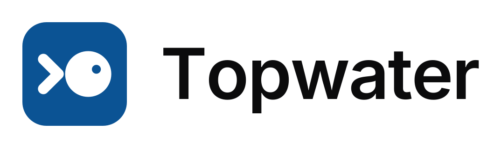

Topwater gives an LLM agent one `bash` tool backed by a simulated Linux shell running inside your .NET process:
a bash interpreter, an in-memory Ubuntu-like filesystem, about 100 standard commands (`grep`, `sed`, `awk`,
`jq`, `find`, `tar`, ...), and your own C# methods as command-line programs.

```bash
dotnet add package Topwater --prerelease
```

## Use

```csharp
using Topwater;

var shell = new Shell();
shell.Fs.WriteAllText("/home/agent/notes.txt", "hello");

// Give your model one tool: BashTool.Name, BashTool.Description, BashTool.InputSchemaJson.
// When it calls the tool, run the command and send the text back:
string output = await BashTool.ExecuteAsync(shell, "grep -c hello notes.txt");
```

Register your own methods and the model finds them with `help` and `--help`, and pipes them into `jq` like any program:

```csharp
public class Tools
{
    [Command("orders", Description = "List orders")]
    public IEnumerable<Order> Orders(string? status = null) => Db.Orders(status);
}

shell.Register(new Tools());   // agent: orders --status open | jq -r '.[].Customer'
```

## Safe by default

Commands are interpreted in your process and only touch the in-memory filesystem. Runaway loops, slow regular
expressions, oversized output, calls that run too long and runaway memory or disk use are all cut off. Nothing the
agent types reaches your machine unless you register a real host program, an MCP server or an HTTP API.

## More

- [Reference](https://github.com/gr-ant/Topwater/blob/main/docs/reference.md): the shell language, every command, limits and safety
- [Topwater.Mcp](https://www.nuget.org/packages/Topwater.Mcp): mount an MCP server as a command
- [Topwater.AI](https://www.nuget.org/packages/Topwater.AI): use the shell as a Microsoft.Extensions.AI tool
- [Source and issues](https://github.com/gr-ant/Topwater) · MIT licensed
